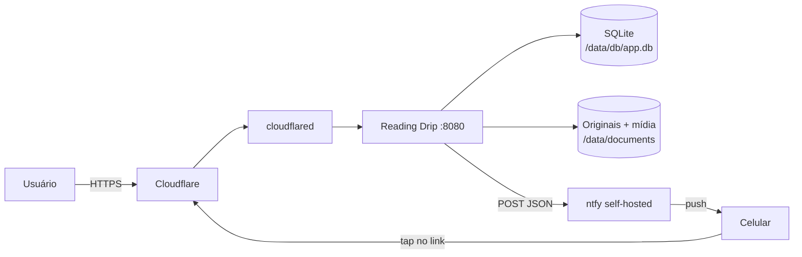
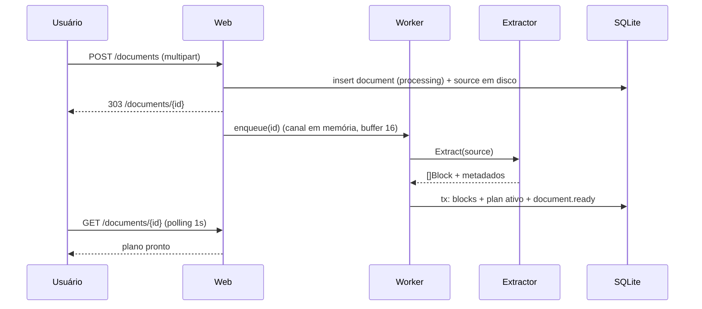

# Arquitetura

## Visão geral

Um único processo Go contém: servidor HTTP, agendador, extração, segmentação e cliente ntfy. Não há fila externa, cache externo ou banco separado. O estado vive em SQLite + diretório `/data`.



O ntfy é acessado pela URL **interna** (ex.: `http://ntfy:8080`) para evitar voltar pela Cloudflare. Os links enviados usam a URL **pública** (`APP_BASE_URL`).

## Componentes

| Pacote | Responsabilidade | Depende de |
|---|---|---|
| `cmd/app` | Entrypoint HTTP: config, store, auth, importador, fila, servidor e shutdown | `platform`, `store`, `auth`, `library`, `ingest`, `web` |
| `cmd/readingdrip` | CLI headless (`plan`, `version`) | `docs`, `blocks`, `plan` |
| `cmd/spike-pdf` | Spike de extração PDF (`-tags pdfspike`) | `docs/pdf` |
| `internal/docs` | Detecção de formato e extratores: `md`, `epub`, `pdf` → `[]blocks.Block` | goldmark, x/net/html, go-fitz |
| `internal/docs/markdown` | Markdown → blocos (goldmark AST) | goldmark, `blocks` |
| `internal/auth` | Sessão da UI: Argon2id, cookie HMAC, rate limit, redirecionamento de login | `x/crypto/argon2` |
| `internal/ingest` | Worker de um documento e fila em memória (1 por vez) | `docs`, `blocks`, `plan`, `store` |
| `internal/library` | Importação: validação, sha256, dedup, original em disco, enfileiramento | `docs`, `store` |
| `internal/blocks` | Modelo de bloco, árvore de seções, normalização, estimador de tempo | x/text |
| `internal/plan` | Segmentador puro: `(blocos, pacing) → plano` | `blocks` |
| `internal/store` | Repositório SQLite, migrações, queries | modernc.org/sqlite |
| `internal/delivery` | Composição da mensagem (recap, rodapé, agrupamento) e cliente ntfy com retry | `blocks`, `store` |
| `internal/schedule` | Ticker, calendário, criação de runs, catch-up | `store`, `delivery` |
| `internal/web` | Rotas HTTP: login/logout, upload multipart, health/ready, headers de segurança, telas em templ (biblioteca, detalhe, plano, download) e assets embutidos | `auth`, `store`, `library`, `views` |
| `internal/platform` | Configuração por ambiente e logging | — |

Regra de dependência: `plan` **não** importa `store` nem `web`. É uma biblioteca pura, testável com `CGO_ENABLED=0`. O CGO do `go-fitz` fica confinado em `internal/docs/pdf` atrás da build tag `cgo`, com stub para builds sem CGO.

## Fluxo de importação



Consequências:
- upload nunca bloqueia no parse (Cloudflare corta em 100 s);
- uma extração por vez (`semaphore=1`) para limitar memória;
- falha deixa o documento em `failed` com erro legível e permite “reprocessar”.

## Fluxo de entrega diária

```mermaid
sequenceDiagram
    participant S as Scheduler
    participant DB as SQLite
    participant D as Delivery
    participant N as ntfy

    S->>DB: INSERT run(run_date) ON CONFLICT DO NOTHING
    alt run nova ou pendente
        S->>DB: chunks pendentes por documento ativo
        S->>D: compor mensagem (breadcrumb + recap + corpo)
        D->>N: POST / (JSON)
        alt 2xx
            D->>DB: marca chunk sent, item sent
        else erro
            D->>DB: registra tentativa; retry com backoff
        end
    end
```

O cursor avança **por item**, não pela run. Um documento que falhou não bloqueia os outros, e será retentado na próxima execução.

`delivery.Compose` é puro: recebe as doses já montadas (chunk, blocos do anterior e do próximo, links, percentual) e devolve uma ou mais mensagens. Os links vêm de `links.Signer` (tokens HMAC escopados para leitura e para “marcar lido”), injetado no `schedule.Runner`; a página correspondente é pública e valida o token no lugar da sessão. Uma mensagem agrupada cabe no limite; acima dele, o scheduler publica uma mensagem por documento. `delivery.Client.Publish` só fala HTTP e classifica o erro para retry. Ver [`delivery-ntfy.md`](./delivery-ntfy.md).

`schedule.Runner` é o único dono do relógio: recebe `platform.Clock`, lê `schedule.*`/`ntfy.*` do banco, decide a run do dia e o catch-up, monta as doses e publica. O tick é serializado por `TryLock`; a run roda inteira na goroutine do ticker e `Stop` cancela e espera. Run `running` é retomada no próximo start reenviando só itens `pending`. Ver [`scheduling.md`](./scheduling.md).

## Estrutura de pastas

```
cmd/app/                 entrypoint HTTP (wiring + shutdown)
cmd/readingdrip/         CLI headless (plan, version)
cmd/spike-pdf/           spike de PDF (-tags pdfspike)
internal/
  docs/                  file.go: detecção de formato e despacho para o extrator
    markdown/            goldmark → blocos
    epub/                archive/zip + x/net/html → blocos
    pdf/                 go-fitz → HTML estruturado → blocos (build tag cgo)
      extract_stub.go    retorno de erro sem CGO
  blocks/                block.go, normalize.go, estimate.go, tree.go
  plan/                  plan.go, pack.go, validate.go, format.go
  auth/                  Argon2id, cookie HMAC, rate limit (ADR-0013)
  ingest/                worker + fila: extração → blocos → plano → status
  library/               importação: validação, sha256, dedup, original, enqueue
  store/                 store.go, migrate.go, documentos/blocos/config/eventos/planos/runs, migrations/*.sql
  delivery/              compose.go, ntfy.go
  links/                 tokens HMAC do leitor e das ações (ADR-0010)
  schedule/              settings.go, runner.go, manual.go
  web/                   server.go, login.go, upload.go, pages.go, config.go, reader.go, static.go
    assets/              app.css, app.js (go:embed)
    views/               layout.templ, login.templ, biblioteca.templ, detalhe.templ, plano.templ, leitor.templ, erro.templ
  platform/              config.go, log.go, clock.go
testdata/
  md/                    fixtures Markdown
  epub/                  fixture + gerador determinístico
  pdf/                   fixtures da próxima etapa
  golden/                planos esperados (*.plan.txt)
```

## Dependências

| Módulo | Uso | Observação |
|---|---|---|
| `github.com/a-h/templ` | views | gera `.go` no build |
| `github.com/yuin/goldmark` | Markdown | GFM + footnotes |
| `golang.org/x/net/html` | EPUB/HTML | parser HTML5 tolerante ([ADR-0012](./adr/0012-epub-zip-xhtml.md)) |
| `golang.org/x/text` | normalização | NFC |
| `github.com/gen2brain/go-fitz` | PDF | CGO, libs estáticas arm64; `SPIKE-01` concluído |
| `modernc.org/sqlite` | banco | sem CGO |
| `github.com/google/uuid` | IDs | apenas se necessário (usar INTEGER é padrão) |
| `golang.org/x/crypto` | argon2id | hash da senha da UI |

Sem framework web, sem ORM, sem lib de cron, sem CDN no runtime. CSS e JS são próprios e embutidos ([ADR-0014](./adr/0014-ui-css-js-proprios.md)); Alpine/Tailwind ficam adiados para as telas interativas.

## Orçamento de recursos

| Cenário | RSS esperado |
|---|---|
| Idle (HTTP + ticker) | 25–45 MiB |
| Upload + extração MD/EPUB | 50–80 MiB |
| Extração PDF de texto, 300 páginas | 120–200 MiB |
| Extração PDF com figuras grandes (medido: 75 páginas) | até 325 MiB — ver `Q-016` |
| Entrega | 40–60 MiB |

Controles: `GOMEMLIMIT=96MiB`, `GOGC=50`, `GOMAXPROCS=2`, semáforo de extração, streaming de upload para disco, `http.Server` com `ReadHeaderTimeout`, body limit e timeouts.

`GOMEMLIMIT`/`GOGC` só controlam o heap Go. O pico de PDF com figuras vem do `HTML()` do MuPDF, que embute as imagens em base64: reduzir `fitz.MaxStore` ajuda (325 → 229 MiB com 32 MiB), mas ainda estoura o orçamento. `SPIKE-04` em ARM64 e a alternativa de extrair texto sem `HTML()` continuam em aberto (`Q-016`).

## Decisões relacionadas

- [ADR-0001](./adr/0001-stack-go-templ-alpine-tailwind.md) — stack
- [ADR-0002](./adr/0002-modelo-de-blocos-normalizado.md) — modelo de blocos
- [ADR-0003](./adr/0003-pdf-com-go-fitz-cgo.md) — PDF/CGO
- [ADR-0008](./adr/0008-build-arm64-distroless.md) — build ARM64
- [ADR-0010](./adr/0010-cloudflare-dominio-proprio-links-assinados.md) — exposição e links
