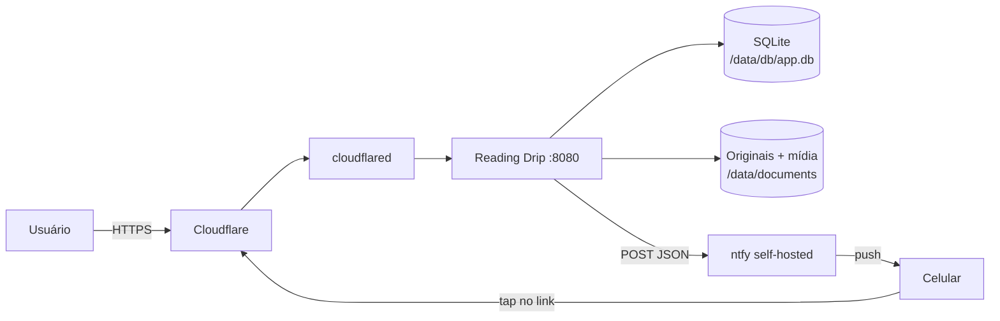
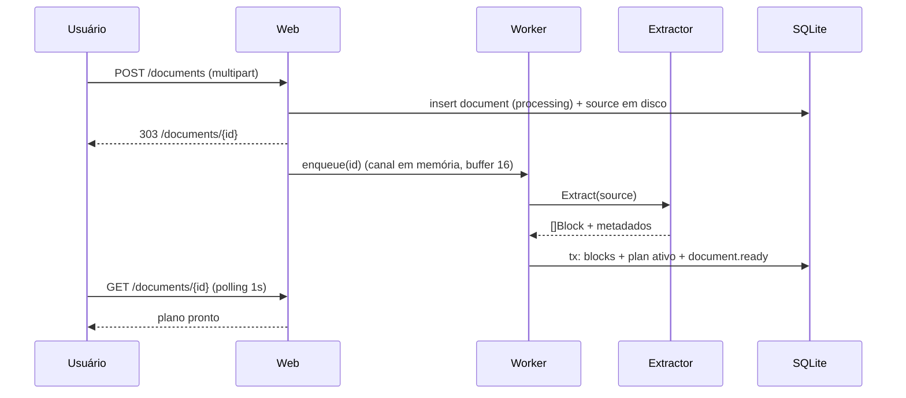

# Arquitetura

## Visão geral

Um único processo Go contém: servidor HTTP, agendador, extração, segmentação e cliente ntfy. Não há fila externa, cache externo ou banco separado. O estado vive em SQLite + diretório `/data`.



O ntfy é acessado pela URL **interna** (ex.: `http://ntfy:8080`) para evitar voltar pela Cloudflare. Os links enviados usam a URL **pública** (`APP_BASE_URL`).

## Componentes

| Pacote | Responsabilidade | Depende de |
|---|---|---|
| `cmd/app` | Wiring, flags/env, lifecycle, shutdown gracioso | todos |
| `cmd/readingdrip` | CLI headless da FASE-0 (`plan`, `version`) | `docs/markdown`, `blocks`, `plan` |
| `internal/docs` | Detecção de formato e extratores: `md`, `epub`, `pdf` → `[]blocks.Block` | goldmark, x/net/html, go-fitz |
| `internal/docs/markdown` | Markdown → blocos (goldmark AST) | goldmark, `blocks` |
| `internal/blocks` | Modelo de bloco, árvore de seções, normalização, estimador de tempo | x/text |
| `internal/plan` | Segmentador puro: `(blocos, pacing) → plano` | `blocks` |
| `internal/store` | Repositório SQLite, migrações, queries | modernc.org/sqlite |
| `internal/delivery` | Composição da mensagem, cliente ntfy, retry | `store`, `plan` |
| `internal/schedule` | Ticker, calendário, criação de runs, catch-up | `store`, `delivery` |
| `internal/web` | Handlers, middleware, auth, templ | `store`, `plan`, `delivery` |
| `internal/platform` | Clock, IDs, logging, config | — |

Regra de dependência: `plan` **não** importa `store` nem `web`. É uma biblioteca pura, testável com `CGO_ENABLED=0`. O CGO do `go-fitz` fica confinado em `internal/docs/pdf` atrás da build tag `cgo`, com stub para builds sem CGO.

## Fluxo de importação



Consequências:
- upload nunca bloqueia no parse (Cloudflare corta em 100 s);
- uma extração por vez (`semaphore=1`) para limitar memória;
- falha deixa o documento em `failed` com erro legível e permite “reprocessar”.

## Fluxo de entrega diária

```mermaid
sequenceDiagram
    participant S as Scheduler
    participant DB as SQLite
    participant D as Delivery
    participant N as ntfy

    S->>DB: INSERT run(run_date) ON CONFLICT DO NOTHING
    alt run nova ou pendente
        S->>DB: chunks pendentes por documento ativo
        S->>D: compor mensagem (breadcrumb + recap + corpo)
        D->>N: POST / (JSON)
        alt 2xx
            D->>DB: marca chunk sent, item sent
        else erro
            D->>DB: registra tentativa; retry com backoff
        end
    end
```

O cursor avança **por item**, não pela run. Um documento que falhou não bloqueia os outros, e será retentado na próxima execução.

## Estrutura de pastas

```
cmd/app/                 main.go (HTTP + scheduler)
cmd/readingdrip/         CLI headless (plan, version)
internal/
  docs/                  detecção de formato (registry na FASE-1)
    markdown/            goldmark → blocos
    epub/                archive/zip + x/net/html → blocos
    pdf/                 go-fitz → blocos (build tag cgo, após SPIKE-01)
      pdf_stub.go        retorno de erro sem CGO
  blocks/                block.go, normalize.go, estimate.go, tree.go
  plan/                  plan.go, pack.go, validate.go, format.go
  store/                 sqlite.go, migrations/*.sql, repositórios
  delivery/              compose.go, ntfy.go, retry.go
  schedule/              ticker.go, calendar.go
  web/                   routes.go, handlers/, middleware/, views/
  platform/              clock.go, config.go, log.go
web/
  static/                input.css, app.js, alpine.min.js
  views/                 *.templ
testdata/
  md/                    fixtures Markdown
  epub/                  fixture + gerador determinístico
  pdf/                   fixtures da próxima etapa
  golden/                planos esperados (*.plan.txt)
```

## Dependências

| Módulo | Uso | Observação |
|---|---|---|
| `github.com/a-h/templ` | views | gera `.go` no build |
| `github.com/yuin/goldmark` | Markdown | GFM + footnotes |
| `golang.org/x/net/html` | EPUB/HTML | parser HTML5 tolerante ([ADR-0012](./adr/0012-epub-zip-xhtml.md)) |
| `golang.org/x/text` | normalização | NFC |
| `github.com/gen2brain/go-fitz` | PDF (planejado) | CGO, libs estáticas arm64; após `SPIKE-01` |
| `modernc.org/sqlite` | banco | sem CGO |
| `github.com/google/uuid` | IDs | apenas se necessário (usar INTEGER é padrão) |
| `golang.org/x/crypto` | argon2id | hash da senha da UI |
| **Alpine.js** | UI | vendorizado em `web/static` (sem CDN) |
| **Tailwind CLI** | CSS | apenas no build |

Sem framework web, sem ORM, sem lib de cron, sem CDN no runtime. Alpine é vendorizado para funcionar offline e respeitar CSP (`script-src 'self'`).

## Orçamento de recursos

| Cenário | RSS esperado |
|---|---|
| Idle (HTTP + ticker) | 25–45 MiB |
| Upload + extração MD/EPUB | 50–80 MiB |
| Extração PDF 300 páginas | 120–200 MiB |
| Entrega | 40–60 MiB |

Controles: `GOMEMLIMIT=96MiB`, `GOGC=50`, `GOMAXPROCS=2`, semáforo de extração, streaming de upload para disco, `http.Server` com `ReadHeaderTimeout`, body limit e timeouts.

## Decisões relacionadas

- [ADR-0001](./adr/0001-stack-go-templ-alpine-tailwind.md) — stack
- [ADR-0002](./adr/0002-modelo-de-blocos-normalizado.md) — modelo de blocos
- [ADR-0003](./adr/0003-pdf-com-go-fitz-cgo.md) — PDF/CGO
- [ADR-0008](./adr/0008-build-arm64-distroless.md) — build ARM64
- [ADR-0010](./adr/0010-cloudflare-dominio-proprio-links-assinados.md) — exposição e links
